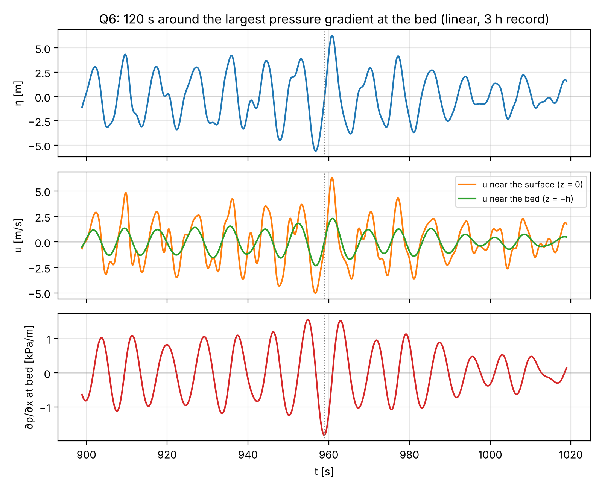
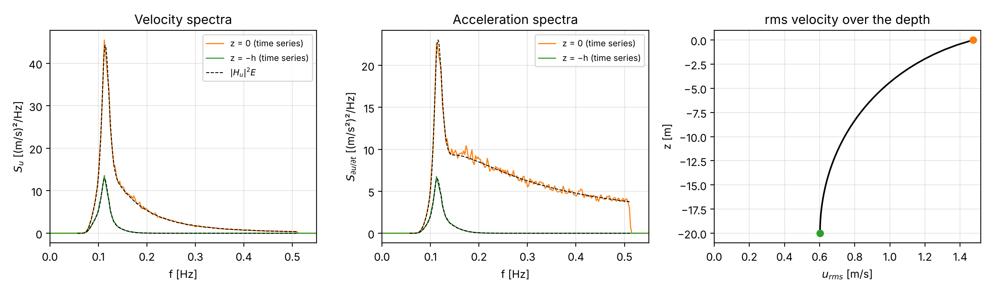

# Method

## Input and realisation

We used the linear random-phase realisation of Question 4a without any change: JONSWAP spectrum with $H_{m0} = 6$ m, $T_p = 8.8$ s and $\gamma = 3.3$, water depth $h = 20$ m, record length $D = 3$ h ($\Delta f = 1/D$), 4910 components between $0.5f_p$ and $4.5f_p$, time step $\Delta t = 0.1$ s and seed 2026. The script recomputes $\eta(t)$ and reproduces $H_{m0} = 6.001$ m, so the kinematics below belong to the same sea state and the same waves as Questions 4 and 5. The assignment allows linear wave theory, so we used only the first-order (free) waves. We took $\rho = 1025$ kg/m³ for sea water.

## Linear transfer functions

Every component of $\eta$ is passed through the linear transfer function of the quantity we want (Lecture 5, slide 15). For the horizontal velocity and the local acceleration at level $z$ (Lecture 3, slide 16):

$$u(z,t) = \sum_{i=1}^{N} a_i \omega_i \frac{\cosh k_i(z+h)}{\sinh k_i h}\cos(\omega_i t + \varphi_i), \qquad \frac{\partial u}{\partial t}(z,t) = -\sum_{i=1}^{N} a_i \omega_i^2 \frac{\cosh k_i(z+h)}{\sinh k_i h}\sin(\omega_i t + \varphi_i).$$

The horizontal pressure gradient follows from the linearised Euler equation for the undisturbed wave (Lecture 4, slide 14), $-\partial p/\partial x = \rho\,\partial u/\partial t$, so

$$\frac{\partial p}{\partial x}(z,t) = -\rho \frac{\partial u}{\partial t}(z,t), \qquad H_{\partial p/\partial x}(f) = \rho\,\omega^2 \frac{\cosh k(z+h)}{\sinh kh}.$$

We evaluated these at two levels:

- **Near the bed:** $z = -h$, where $\cosh k(z+h) = 1$ and $H_u = \omega/\sinh kh$. Potential flow does not satisfy the no-slip condition, so this is the velocity just above the wave boundary layer (a few centimetres to decimetres thick), which is the velocity that the bed protection formulas use. The pressure gradient does not change across the thin boundary layer, so the value at $z = -h$ also acts on the bed itself.
- **Near the surface:** $z = 0$, the still water level, as in Question 4. Here $H_u = \omega/\tanh kh$. Linear theory is only defined up to $z = 0$. With Wheeler stretching the velocity at the instantaneous surface $z = \eta$ is equal to the value computed at $z = 0$, so $u(0,t)$ can also be read as the stretched surface velocity.

## Statistics

For each signal $r(t)$ we determined:

1. **The rms value**, from the time series and from the spectrum $S_r(f) = |H_r(f)|^2 E(f)$: $r_{rms} = \sigma_r = \sqrt{m_{0,r}}$ (Lecture 5, slide 15). The two must agree, which verifies the time series.
2. **The mean zero-crossing period** $T_{m02,r} = \sqrt{m_{0,r}/m_{2,r}}$ and the spectral bandwidth $\nu = \sqrt{m_0 m_2/m_1^2 - 1}$.
3. **The peak of every individual cycle.** A zero up-crossing analysis of $r(t)$ gives one cycle per "wave" in $r$; we took the positive maximum and the negative minimum of every cycle. These are the velocity (or pressure gradient) amplitudes of the individual waves.
4. **The exceedance distribution of the peaks**, compared with the Rayleigh distribution. A linear Gaussian process with a narrow spectrum has Rayleigh-distributed peaks (Lecture 5, slide 14, for $\eta_c$ with $H_s = 4\sigma$):
$$P(\hat r > x) = \exp\left(-\frac{x^2}{2\sigma_r^2}\right).$$
5. **Characteristic values:** the significant value $\hat r_{1/3}$ (mean of the highest third of the peaks; Rayleigh: $2.00\sigma_r$), $\hat r_{1/10}$ (Rayleigh: $2.55\sigma_r$), and the largest value in the 3 h record, compared with the expected maximum of $N$ Rayleigh peaks, $\sigma_r\left(\sqrt{2\ln N} + 0.577/\sqrt{2\ln N}\right)$.

# Results

Figure 1 shows the surface elevation, the velocities and the pressure gradient at the bed around the largest pressure gradient in the record. Figure 2 shows the spectra and the rms velocity over the depth, and Figure 3 the exceedance distributions of the peaks. Table 1 summarises the statistics.

{width=100%}

{width=100%}

{width=100%}

Table 1. Statistics from the 3 h linear time series. Values in brackets are the Rayleigh predictions from $\sigma_r$ of the series.

| Quantity | $u$ near bed [m/s] | $\partial p/\partial x$ at bed [Pa/m] | $u$ near surface [m/s] |
|---|---|---|---|
| $\sigma$ from time series | 0.602 | 450 | 1.474 |
| $\sigma$ from spectrum, $\sqrt{m_{0,r}}$ | 0.602 | 450 | 1.474 |
| $T_{m02,r}$ [s] | 8.6 | 8.2 | 5.4 |
| bandwidth $\nu$ [–] | 0.15 | 0.16 | 0.48 |
| number of cycles in 3 h | 1244 | 1306 | 1969 |
| significant value $\hat r_{1/3}$ | 1.20 (1.21) | 897 (901) | 2.96 (2.95) |
| $\hat r_{1/10}$ | 1.51 (1.53) | 1129 (1146) | 3.75 (3.75) |
| maximum in 3 h | 2.33 (2.37) | 1821 (1773) | 6.32 (5.96) |

## (a) Near the bed

**Velocity.** The rms velocity just above the bed is $\sigma_{u,b} = 0.60$ m/s, and the significant velocity amplitude is $\hat u_{b,1/3} = 1.20$ m/s ($= 2\sigma_{u,b}$, the significant bed velocity $U_s$ of Soulsby, 1997). The largest velocity in 3 h is 2.33 m/s, against 2.37 m/s expected from Rayleigh. A single regular wave with $H = H_s$ and $T = T_p$ gives $\hat u_b = \pi H/(T\sinh kh) = 1.37$ m/s, 14 % more than $\hat u_{b,1/3}$, because the irregular waves of the highest third are on average shorter than $T_p$ and decay more with depth.

The bed acts as a low-pass filter: the factor $1/\sinh kh$ removes the high-frequency waves, so the velocity spectrum at the bed is concentrated around $f_p$ (Figure 2, left), with $\nu = 0.15$ and $T_{m02} = 8.6$ s, close to $T_p$ and much longer than $T_{m02}$ of $\eta$ (7.0 s). Because the signal is narrow-banded, its peaks follow the Rayleigh distribution closely (Figure 3, left), and the significant and 1/10 values agree with Rayleigh to within 2 %. Above an exceedance probability of about $10^{-2}$ the peaks scatter around the Rayleigh line, as expected for the tail of 1244 cycles.

**Pressure gradient.** The horizontal pressure gradient at the bed has $\sigma = 450$ Pa/m $= 0.045\,\rho g$, a significant amplitude of 897 Pa/m $= 0.089\,\rho g$, and a maximum in 3 h of **1.82 kPa/m $= 0.18\,\rho g$**, against 1.77 kPa/m expected from Rayleigh. The regular-wave estimate $\rho\omega^2 (H_s/2)/\sinh kh = 1.0$ kPa/m lies between the significant and the 1/10 value. The factor $\omega^2$ gives slightly more weight to the higher frequencies than for the velocity, but these are still filtered by the depth, so the signal remains narrow-banded ($\nu = 0.16$) and Rayleigh fits well (Figure 3, right).

The pressure gradient is 90° out of phase with the velocity: the maximum occurs when $u_b$ changes sign, not under a crest or trough. Figure 1 shows this for the largest event ($t = 959$ s): $u_b \approx 0$, during the steep rise from the deepest trough to the highest crest in this part of the record. For the bed protection (Part II) this means that the largest drag (proportional to $u_b^2$) and the largest pressure-gradient (inertia) loads on stones do not act at the same time. The ratio $|\partial p/\partial x|/(\rho g)$ is the horizontal hydraulic gradient, which is the quantity that drives flow through a filter layer (Part II, Question 7).

## (b) Near the surface

At the still water level the rms velocity is $\sigma_{u,s} = 1.47$ m/s, 2.4 times the value at the bed (Figure 2, right), the significant velocity amplitude is $\hat u_{s,1/3} = 2.96$ m/s and the maximum in 3 h is 6.3 m/s. Near the surface the high-frequency waves are not filtered: $H_u = \omega/\tanh kh$ grows with frequency, so the spectrum has a long tail (Figure 2, left), $\nu = 0.48$ and $T_{m02} = 5.4$ s. The signal therefore contains many small cycles riding on the larger waves (1969 cycles in 3 h, against about $D/T_{m02} \approx 1540$ waves in $\eta$). The zero-crossing analysis still gives peaks that follow Rayleigh closely up to an exceedance probability of about $10^{-2}$; the significant and 1/10 values agree with Rayleigh within 0.5 %. The few largest peaks lie above the Rayleigh line (6.3 m/s against 6.0 m/s expected), where the short waves add to the velocity under the highest crests.

The near-surface acceleration, which is needed for the inertia force on the pile in Part II, is even more broad-banded: $\sigma = 1.71$ m/s², significant 3.42 m/s², maximum 7.2 m/s² (Figure 2, middle). Its value depends on the high-frequency cut-off of the spectrum ($4.5 f_p$), which is a modelling choice.

# Assumptions and limitations

- **Linear theory.** At $k_p h = 1.23$ and an Ursell number of 8, the second-order bound waves are not small (Question 4b). The super-harmonics make the velocity under the crests higher and under the troughs lower near the surface, but they decay quickly with depth (wavenumber $k_i + k_j$), so near the bed they matter much less. The sub-harmonic bound waves (Question 4c) add a slowly varying return current that does reach the bed in 20 m depth, and would make the distribution of $u_b$ skewed. The linear results are therefore most reliable for the bed and least reliable for the extremes near the surface.
- **Velocity above the still water level.** We evaluated the near-surface velocity at $z = 0$ (equivalent to Wheeler stretching at $z = \eta$). Linear extrapolation, $u(\eta) = u(0) + \eta\,\partial u/\partial z$, gives much higher crest velocities (a maximum of 12 m/s in this record), because the factor $k$ amplifies the short waves; this is unphysical, which is why stretching is preferred. The true crest velocity lies between these estimates, and the highest crests are close to breaking ($u \approx c$), which linear theory cannot describe.
- **Boundary layer.** The near-bed velocity is the potential-flow velocity just outside the wave boundary layer. The bed shear stress needs a friction factor (e.g. $\tau_b = \tfrac12 \rho f_w \hat u_b^2$), and the combination with the steady current $U$ is not included here.
- **Sampling variability.** One 3 h realisation (one seed) with deterministic amplitudes. The rms and significant values are stable (they match the spectral values within 1 %), but the maxima vary from seed to seed; the Rayleigh expected maximum is the more robust design value.
- **Long-crested waves, constant depth, no current and no structure.**

# References

- Course slides CIEM4000-26, Fluid-Structure Interaction: Lecture 3 (Linear surface gravity waves I), Lecture 4 (Linear surface gravity waves II), Lecture 5 (Wave statistics and spectra).
- Longuet-Higgins, M.S. (1952). On the statistical distribution of the heights of sea waves. Journal of Marine Research 11(3), 245–266.
- Longuet-Higgins, M.S. (1975). On the joint distribution of the periods and amplitudes of sea waves. Journal of Geophysical Research 80(18), 2688–2694.
- Soulsby, R.L. (1997). Dynamics of Marine Sands. Thomas Telford, London.
- Wheeler, J.D. (1970). Method for calculating forces produced by irregular waves. Journal of Petroleum Technology 22(3), 359–367.
